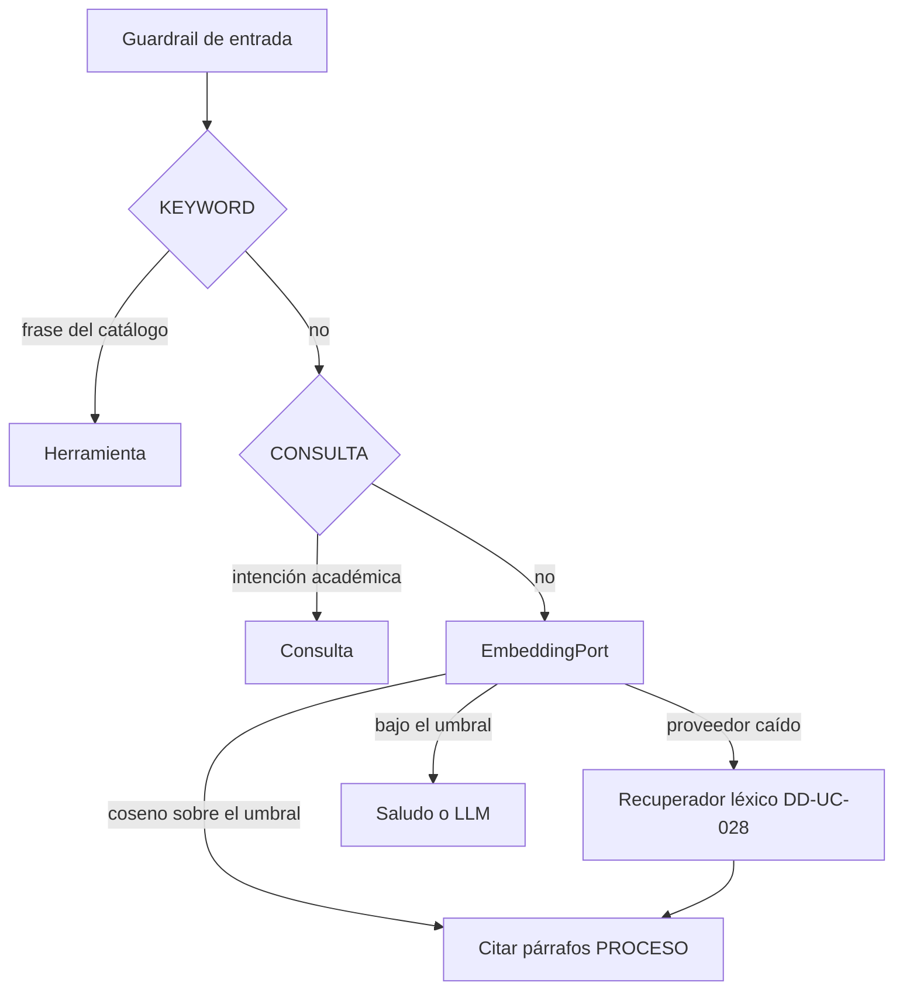

# Design Doc `DD-UC-030` — RAG vectorial del camino PROCESO

> **Qué es**: sustituye el ranking por solapamiento de tokens de `DD-UC-028` por similitud de embeddings. El nodo sigue citando párrafos del corpus y no le pide al modelo que redacte.
>
> **Relación**: `FSD-UC-016` es la regla que el corpus explica (`round` HALF_UP, sin `floor()` en el modelo genérico). `NFR-007` prohíbe PII en logs y acota qué se puede enviar al proveedor. No hay un `FSD-UC` propio del asistente; el comportamiento vivo de este nodo está en `DD-UC-028` y en `ADR-0024`.

## 1. Objetivo y contexto

- **Qué resuelve**: una pregunta de proceso dicha con otras palabras recupera el párrafo institucional correcto. Hoy el regex de `esPreguntaDeProceso` deja fuera «¿Cuándo se puede cargar una nota?» y «¿Qué pasa si una sección no tiene notas?», y el overlap mete un segundo párrafo (alcance, `BR-001`) que la pregunta no pidió.
- **Caso de uso**: `FSD-UC-016` — [`docs/product/FSD.md`](../product/FSD.md). El asistente explica esa regla; no la calcula. `NFR-007` — misma sección de NFR.
- **Dentro**:
  - Puerto `EmbeddingPort` y adaptador Spring AI en `shared.ai.infrastructure`.
  - Índice en memoria de los mismos párrafos que ya parte `RecuperadorProcesosEdusync` (seis markdown, corte por línea en blanco, mínimo 40 caracteres).
  - Ranking por coseno, tope 2, descarte bajo el umbral.
  - Respaldo léxico solo si el embedding falla.
  - Umbral y modelo en `application.yml`.
- **Fuera**:
  - Que el LLM reescriba los fragmentos (alternativa B de `ADR-0024`).
  - Chroma, pgvector, caché semántico, nodo ESCALAR, checkpoint.
  - Cambiar `KEYWORD`, `CONSULTA`, guardrails, catálogo de tools o el contrato REST.
  - Meter en el corpus las negativas de seguridad («no puedo aprobar»). Eso sigue en el guardrail y, si no hay match, en el LLM.
  - Reescribir `respuestas/v3.json` ni la compuerta `python evals/evaluar.py v3`.
  - Nueva dependencia fuera del BOM `spring-ai-bom` 2.0.0 ya fijado (`ADR-0017`).

## 2. Diseño (el "cómo") `[humano+máquina]`

### 2.1 Dónde entra en el grafo

El orden no cambia: guardrail de entrada, `KEYWORD`, `CONSULTA`, `PROCESO`, saludo, LLM.

`KEYWORD` y `CONSULTA` no llaman a `EmbeddingPort`.

### 2.2 Componentes

| Pieza | Capa | Rol |
|-------|------|-----|
| `EmbeddingPort` | application (interfaz; sin Spring AI) | `float[] embed(String texto)` para un texto. El índice llama una vez por párrafo al arranque y una vez por pregunta |
| Adaptador Gemini u Ollama | infrastructure | `EmbeddingModel` del starter que ya está en el `pom` (`spring-ai-starter-model-openai` o `spring-ai-starter-model-ollama`), el mismo criterio de proveedor que `ADR-0023` |
| `IndiceProcesos` | application | Parte el corpus igual que hoy, guarda vectores en memoria, ordena por coseno, descarta bajo el umbral, devuelve como máximo 2 `FragmentoProceso` |
| `RecuperadorProcesosEdusync` | application | Se queda. Solo se usa si `embed` lanza o el índice no pudo construirse |
| `EjecutarConsultaAgenteService` | application | Arma `hayProceso` con el índice. El formateo «Según los procesos de EduSync» + `Fuente:` no cambia |

`FragmentoProceso` no gana un campo nuevo. Un fragmento aceptado sigue con `puntuacion >= 1` para que `hayMatch()` no cambie de contrato. El coseno no se publica en la respuesta HTTP.

### 2.3 Configuración

En `application.yml`, junto al bloque `edusync.ai` que ya existe:

- `edusync.ai.embedding.model`: `${EDUSYNC_AI_EMBEDDING_MODEL:}`. Vacío hasta que `PR-IMPL-030` verifique el id contra el proveedor activo y lo deje documentado en `.env.example`. No se escribe la clave.
- `edusync.ai.proceso.umbral-similitud`: `${EDUSYNC_AI_PROCESO_UMBRAL}`. El número inicial sale del test de calibración, no de los 0,85 de la compuerta offline.
- `edusync.ai.proceso.top-k`: 2.

La base URL y `GEMINI_API_KEY` son las de `ADR-0023`. No hay un secreto nuevo.

### 2.4 Arranque y fallo

Al arrancar se embeben los párrafos del corpus. Si eso falla, la aplicación igual levanta y cada pregunta de proceso usa el léxico. Si el corpus ya está indexado y falla solo la pregunta, esa pregunta usa el léxico. Si el embedding responde y el mejor coseno queda bajo el umbral, no hay `PROCESO`.

No se loguea la pregunta, el párrafo ni el vector en INFO. Un warning de caída puede decir «embedding de procesos no disponible» y el nombre del proveedor.

### 2.5 Qué se embebe

La pregunta ya limpia por el guardrail de entrada, y los párrafos del classpath. No el historial, no el JSON de una tool, no filas de calificación, no RUDE.

## 3. Alternativas consideradas

| Alternativa | Pros | Contras | ¿Elegida? |
|-------------|------|---------|-----------|
| A. Seguir con overlap de tokens | Sin red | No cubre paráfrasis; mezcla párrafos | no |
| B. Embeddings y el LLM redacta | Respuesta más breve | Inventa cifras y gasta un turno de chat | no |
| C. Chroma o pgvector | Índice durable | Fuera del stack; el corpus no es multitenant | no |
| D. Embeddings en memoria, cita textual, léxico solo si el proveedor cae | Usa Spring AI ya adoptado; mantiene la cita | La pregunta sale al proveedor de embeddings | sí → `ADR-0024` |

## 4. Impacto en las specs vivas `[máquina]`

| Artefacto vivo | Cambio | ¿Delta vs DTI vFinal? |
|----------------|--------|-----------------------|
| `docs/product/FSD.md` (`FSD-UC-016`) | Sin cambio de la regla de cálculo. Este DD no toca `CalculoNotas` | no |
| `docs/product/PRD.md` (`PRD-NFR-007`) | Sin cambio de redacción. El envío de la pregunta al embedding queda acotado en `ADR-0024` | no |
| `docs/product/DTP.md` | Al ejecutar `PR-IMPL-030`, fila en §A.1 y nota de que el RAG de procesos pasa a embeddings en memoria (`ADR-0024`). `DD-UC-028` permanece como respaldo léxico | sí → `ADR-0024` |
| `docs/design/DD-UC-028.md` | Una línea que apunta aquí. El léxico deja de ser el ranking principal | no |

> El baseline (`docs/baseline/`) no se toca. `dtp-sync` corre cuando haya código, no con este diseño.

## 5. Prompts usados `[máquina]`

| Prompt | Tarea | Artefacto generado |
|--------|-------|--------------------|
| `PR-IMPL-030` | Puerto, índice, adaptador, tests con puerto falso, yml | `shared.ai` (application + infrastructure), `application.yml`, `.env.example` |

Estado del prompt: aprobado, ejecución pendiente.

## 6. Plan de pruebas y evals

- **Unit**: `EmbeddingPort` falso.
  - La paráfrasis de una sección sin notas devuelve el párrafo que contiene `INCOMPLETO` y no inventa un 0, cuando el falso coloca ese vector como el más cercano.
  - «lista los cursos» resuelve `KEYWORD` y el puerto no recibe la pregunta.
  - El puerto que lanza hace que «¿Cómo se redondea el promedio de sección?» siga citando por el léxico.
  - Una pregunta de clima, con todos los cosenos bajo el umbral, no toma `PROCESO`.
  - El segundo fragmento bajo el umbral no aparece en el texto.
- **Integration**: sin red y sin Testcontainers. `ModularityTests` sigue en verde. `application/` y `domain/` no importan `org.springframework.ai`.
- **E2E**: no hay Gherkin nuevo. El contrato HTTP no cambia.
- **Evals**: la defensa sigue siendo `python evals/evaluar.py v3` (código 0). Volver a correr `consultar_asistente.py` es una comprobación manual posterior, con el proveedor real; no es el gate de CI. Un HTTP 500 del chat no se cuenta como acierto de este índice.

## 7. Definition of Done (checklist)

- [x] `fsd_uc` declarado y enlazado (`FSD-UC-016`, `NFR-007`).
- [x] Diseño (§2) y alternativas (§3) documentados.
- [x] `ADR-0024` creado y enlazado.
- [x] §4 Impacto en specs vivas registrado (sin tocar el baseline).
- [x] `PR-IMPL-030` en `docs/prompts/impl/` y en `PROMPT_MAPPING.md`.
- [ ] Tests de §6 escritos y en verde (los escribe la ejecución del prompt).
- [ ] DTP actualizado vía `dtp-sync` cuando el código exista.
- [ ] PR de implementación declara prompts usados y archivos generados.
