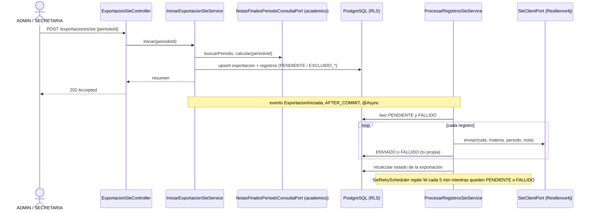

# Design Doc `DD-UC-031` — Exportación de la nota final de periodo al SIE

> **Qué es**: primer feature real del módulo `notassie`. Un `ADMIN` o `SECRETARIA` exporta al SIE, con un clic, la nota final de cada estudiante en cada materia de un periodo `CERRADO`. El envío es asíncrono, idempotente por registro y tolera fallos del SIE.
>
> **Relación**: reescribe `FSD-UC-004` sobre el modelo genérico. `FSD-UC-003` queda reducido a «nota final de periodo» y la calcula `CalculoNotas` (`FSD-UC-016`, ya implementado). `ADR-0025` (propuesta) fija las decisiones. **No es un `FSD-UC` nuevo**: mantiene el identificador `FSD-UC-004` y marca en `docs/product/FSD.md` §4.3 el flujo clásico como superado.
>
> **Estado de las decisiones**: `ADR-0025` está en estado *Propuesta*. Este Design Doc y `PR-IMPL-031` están aprobados para ejecutar solo después de que `ADR-0025` pase a *Aceptada*.

## 1. Objetivo y contexto

- **Qué resuelve**: eliminar la triple digitación. Hoy el módulo `notassie` está vacío y la nota de periodo existe (`GET .../nota-provisional`) pero nada sale de EduSync.
- **Casos de uso**: `FSD-UC-004` y `FSD-UC-003` — [`docs/product/FSD.md`](../product/FSD.md) §4.2/§4.3; `FSD-UC-016` §4.6.
- **Decisiones heredadas de `ADR-0025`**:
  - Un solo motor: `CalculoNotas`, `round` HALF_UP, sin `floor()`.
  - El SIE recibe `rude`, materia, periodo y `notaFinal` entera. Nada más.
  - Solo se exporta si **todas** las secciones del periodo están `COMPLETO` (si no, `EXCLUIDO_NOTA_INCOMPLETA`).
  - Solo un periodo `CERRADO` es exportable. No hay cierre por materia.
  - Clave de idempotencia `rude + materia_id + periodo_id`. Un registro `ENVIADO` no se reenvía nunca.
- **Dentro**:
  - Puerto público `academico.NotasFinalesPeriodoConsultaPort` y su servicio de cálculo por lote.
  - Método `CalculoNotas.notaPeriodoSiCompleto`.
  - Agregados `ExportacionSie` y `RegistroExportacion` en `notassie`, migración `V14`.
  - Casos de uso iniciar/consultar/procesar, evento tras commit, scheduler de reintentos cada 5 min.
  - `SieClientPort` con adaptador HTTP (Resilience4j) y adaptador simulado solo para `dev`.
  - `POST/GET /api/v1/exportaciones/sie` y una consola Angular mínima.
  - Corrección del corpus del asistente que dice que `floor()` está reservado al SIE.
- **Fuera** (diferido por decisión del 10/11/2026, ver `ADR-0025` §3.7): inmutabilidad y `append-only`, `AutorizacionCorreccion`/`FSD-UC-005`, `audit_log`, tabla de centralizador, promedio anual al SIE, boletines PDF (`FSD-UC-007`), notificaciones, cierre de materia (`FSD-UC-002`), formato real del SIE (ver §8).

## 2. Diseño (el "cómo") `[humano+máquina]`

### 2.1 Flujo



### 2.2 Cálculo por lote (módulo `academico`)

Puerto público en la raíz de `academico` (Open Host Service, mismo patrón que `ProfesorConsultaPort`):

```java
public interface NotasFinalesPeriodoConsultaPort {
  Optional<PeriodoResumen> buscarPeriodo(UUID tenantId, UUID periodoId);
  List<NotaFinalPeriodo> calcular(UUID tenantId, UUID periodoId);
}
public record PeriodoResumen(UUID id, String nombre, int orden, boolean cerrado) {}
public record NotaFinalPeriodo(UUID estudianteId, String rude, UUID materiaId,
    String materiaNombre, Integer notaFinal, boolean completa) {}
```

`calcular` recorre las materias con asignación a un curso/paralelo de la gestión del periodo. Para cada materia reutiliza la nómina de `NominaMateriaService` (Inscripción `ACTIVA` ∩ asignación) y las secciones/evaluaciones/calificaciones que ya consulta `ObtenerNotaProvisionalService`, pero **en lote** (una consulta de calificaciones por materia, no una por estudiante). Para no duplicar el armado de entradas, `armarSecciones` se extrae a un colaborador de paquete compartido por ambos servicios.

`CalculoNotas` gana un método estático puro:

```java
/** Nota de periodo entera, o null si alguna sección no está COMPLETO. */
public static Integer notaPeriodoSiCompleto(List<EntradaSeccion> secciones)
```

`calcularNotaPeriodo` no cambia (el docente sigue viendo la nota provisional parcial). El resultado de `calcular` marca `completa = notaFinal != null`. Una materia sin evaluaciones produce `completa = false` para todos sus estudiantes.

### 2.3 Dominio de `notassie`

| Tipo | Campos | Reglas |
|------|--------|--------|
| `ExportacionSie` (Aggregate) | `id`, `tenantId`, `periodoEvaluacionId`, `estado` (`EN_PROGRESO`, `PARCIAL`, `COMPLETA`), `solicitadoPor`, `creadoEn`, `actualizadoEn` | Una por (tenant, periodo). Factory `crear()`. El estado se **deriva** de los contadores de sus registros, nunca se edita a mano |
| `RegistroExportacion` (Aggregate independiente) | `id`, `tenantId`, `exportacionId`, `estudianteId`, `rude`, `materiaId`, `periodoEvaluacionId`, `nota` (Integer, nulo si excluido), `estado`, `intentos`, `ultimoError` (código), `enviadoEn`, `actualizadoEn` | Estados: `PENDIENTE`, `ENVIADO`, `FALLIDO`, `EXCLUIDO_SIN_RUDE`, `EXCLUIDO_NOTA_INCOMPLETA` |
| `RudeValidador` (servicio de dominio puro) | — | `rude` no nulo ni vacío y con longitud dentro de `edusync.sie.rude-longitud-min/max` (ver §8) |

Estado derivado de la exportación, en este orden: `EN_PROGRESO` si algún registro está `PENDIENTE`; `PARCIAL` si ninguno está `PENDIENTE` pero alguno está `FALLIDO`; `COMPLETA` si no hay `PENDIENTE` ni `FALLIDO` (los `EXCLUIDO_*` no impiden `COMPLETA`; se muestran en sus propios contadores). El estado `FALLIDA` del FSD no se usa: un registro fallido se reintenta, no se abandona (no hay tope de intentos en este slice).

Transiciones de `RegistroExportacion`:

| De | A | Cuándo |
|----|---|--------|
| (nuevo) | `PENDIENTE` | nota completa y RUDE válido |
| (nuevo) | `EXCLUIDO_SIN_RUDE` / `EXCLUIDO_NOTA_INCOMPLETA` | no cumple 3.3 de `ADR-0025` |
| `PENDIENTE`, `FALLIDO` | `ENVIADO` | el SIE responde OK |
| `PENDIENTE`, `FALLIDO` | `FALLIDO` | error, timeout o circuito abierto (`intentos`+1) |
| `EXCLUIDO_*` | `PENDIENTE` | al volver a exportar, el dato ya está completo |
| `PENDIENTE`, `FALLIDO` | `PENDIENTE` | al volver a exportar, se refresca `nota` con el cálculo actual |
| `ENVIADO` | — | **terminal e inmutable** |

### 2.4 Casos de uso (`notassie.application`)

| Caso de uso | Resumen |
|-------------|---------|
| `IniciarExportacionSieUseCase` | `@Transactional`. Valida periodo existente del tenant y `CERRADO`, calcula con el puerto de `academico`, hace upsert de la exportación y de los registros según §2.3, publica `ExportacionIniciadaEvent` y devuelve el resumen |
| `ConsultarExportacionSieUseCase` | Resumen con contadores por estado y listado paginado de registros con filtro `estado` (`PageQuery`/`PageResult`) |
| `ProcesarRegistrosSieService` | Toma los registros `PENDIENTE`/`FALLIDO` de una exportación, envía uno por uno y persiste cada resultado en su propia transacción (`REQUIRES_NEW`) para que una caída a mitad conserve el avance |
| `ReintentarExportacionesPendientesUseCase` | Lo invoca el scheduler: por cada tenant activo, busca exportaciones con registros `PENDIENTE`/`FALLIDO` y llama a `ProcesarRegistrosSieService` |

Reglas de proceso:

- El listener es `@TransactionalEventListener(phase = AFTER_COMMIT)` + `@Async`. **`TenantContext` es un `ThreadLocal`** (`shared.tenant.TenantContext`): el hilo asíncrono y el scheduler deben fijarlo explícitamente con el `tenantId` del evento y limpiarlo en `finally`. Sin eso, RLS `FORCE` devuelve cero filas.
- `@EnableAsync` aún no existe en `EduSyncApplication`; se añade junto con un `TaskExecutor` acotado (pocos hilos, cola limitada).
- Una guardia en memoria impide que el listener y el scheduler procesen a la vez la misma exportación. Es suficiente para una sola instancia (mismo criterio que `DD-UC-003`, sin ShedLock). Con varias instancias hará falta un bloqueo en base de datos (ver §8).
- El scheduler necesita la lista de tenants activos. `tenant` no tiene RLS, pero hoy no hay un puerto que la exponga. Se añade `plataforma.TenantActivosPort.listarIdsActivos()` (raíz de `plataforma`, implementado en `plataforma`). La arista `notassie → plataforma` no crea ciclo (`plataforma` no depende de `notassie`).

### 2.5 Integración con el SIE

```java
public interface SieClientPort {
  ResultadoEnvioSie enviar(EnvioSie envio);
}
public record EnvioSie(String rude, String materiaId, String materiaNombre,
    String periodoId, String periodoNombre, int notaFinal) {}
public record ResultadoEnvioSie(boolean ok, String codigoError) {}
```

- `SieHttpClientAdapter`: `RestClient` con timeout 30 s, cabecera `X-SIE-TOKEN` desde `SIE_API_TOKEN`, URL desde `SIE_BASE_URL`. Envuelto en un `CircuitBreaker` Resilience4j programático (módulo `resilience4j-circuitbreaker`, sin starter ni AOP, para no depender de la compatibilidad del starter con Boot 4.1). Parámetros iniciales: ventana 10, mínimo 5 llamadas, umbral 50 %, 60 s abierto, 3 llamadas en semiabierto, todos en `application.yml` (`edusync.sie.*`).
- `SieSimuladoAdapter`: responde OK sin red. **Solo** se activa con `edusync.sie.modo=simulado`, y ese valor solo se pone en `application-dev.yml`. El modo por defecto es `desactivado`: `POST /exportaciones/sie` responde `503 E_SIE_NO_CONFIGURADO`. Así un despliegue sin configurar no marca registros como `ENVIADO` sin haberlos enviado.
- Circuito abierto o timeout → `FALLIDO` con código `E_SIE_CIRCUITO_ABIERTO` / `E_SIE_TIMEOUT`. El texto de la excepción no se guarda (puede traer datos): solo el código.
- Payload provisional (ver §8): `{ "rude", "materiaId", "materiaNombre", "periodoId", "periodoNombre", "notaFinal" }`. No hay nombre de estudiante ni posición de lista.

### 2.6 Persistencia — `V14__notassie_exportacion_sie.sql`

Dos tablas con `tenant_id UUID NOT NULL`, `ENABLE` + `FORCE ROW LEVEL SECURITY` y la política `tenant_isolation` de `V13`.

| Tabla | Columnas clave | Restricciones |
|-------|----------------|---------------|
| `exportacion_sie` | `id`, `tenant_id`, `periodo_evaluacion_id`, `estado`, `solicitado_por`, `creado_en`, `actualizado_en` | `UNIQUE (tenant_id, periodo_evaluacion_id)`, `CHECK estado IN (...)` |
| `exportacion_registro` | `id`, `tenant_id`, `exportacion_id` (FK `ON DELETE CASCADE`), `estudiante_id`, `rude`, `materia_id`, `periodo_evaluacion_id`, `nota`, `estado`, `intentos`, `ultimo_error`, `enviado_en`, `actualizado_en` | `UNIQUE (tenant_id, estudiante_id, materia_id, periodo_evaluacion_id)`, `CHECK estado IN (...)`, índice `(tenant_id, exportacion_id, estado)` |

Decisiones:

- **Sin FK a `periodo_evaluacion`, `estudiante` ni `materia`.** El historial de exportación no debe borrarse ni bloquear el borrado de un periodo, y `notassie` no se acopla a tablas de `academico`.
- La unicidad usa `estudiante_id` y no `rude` porque un `rude` vacío o inválido no puede ser parte de una clave. Como `rude` es único por tenant (`BR-004`), `estudiante_id + materia + periodo` equivale a `rude + materia + periodo`.
- `rude` queda en una columna normal. El cifrado en reposo (`AGENTS.md` §7) lo cubre la infraestructura (KMS/RDS), no esta migración.

### 2.7 API

| Método y ruta | Rol | Resultado |
|---------------|-----|-----------|
| `POST /api/v1/exportaciones/sie` `{periodoId}` | `ADMIN`, `SECRETARIA` | `202` + resumen |
| `GET /api/v1/exportaciones/sie?periodoId=` | `ADMIN`, `SECRETARIA` | `200` resumen o `404 E_EXPORTACION_NO_ENCONTRADA` |
| `GET /api/v1/exportaciones/sie/{id}/registros?estado=&page=&size=` | `ADMIN`, `SECRETARIA` | `200` `PageResponse` de registros |

Resumen: `{ id, periodoId, estado, total, enviados, pendientes, fallidos, excluidosSinRude, excluidosNotaIncompleta, actualizadoEn }`.

Errores (formato `ErrorResponse`): `404 E_PERIODO_NO_ENCONTRADO` (inexistente o de otro tenant), `422 E_PERIODO_NO_CERRADO`, `503 E_SIE_NO_CONFIGURADO`, `404 E_EXPORTACION_NO_ENCONTRADA`. Un `id` de otro tenant devuelve 404, nunca 403.

### 2.8 Logs y PII

En INFO solo se registran `exportacionId`, `tenantId` y contadores. **Nunca** `rude`, `nota`, nombre ni el cuerpo de la respuesta del SIE (`NFR-007`, `AGENTS.md` §7).

### 2.9 UI Angular mínima

`features/notassie/exportacion-sie.page.ts`, ruta `/notassie/exportacion-sie`, roles `ADMIN` y `SECRETARIA` (`role.guard` con `data.roles`), enlace «Exportación SIE» en `shell.component.ts`.

- Lista los periodos `CERRADO` de la gestión activa (`GET /gestiones-escolares/activa/periodos`, ya disponible para ambos roles por `DD-UC-021`).
- Botón «Exportar al SIE» por periodo → `POST`. Muestra contadores, y una tabla paginada de registros con filtro por estado.
- Mientras la exportación esté `EN_PROGRESO` o `PARCIAL`, consulta cada 5 s **solo con la pantalla abierta** y deja de consultar al salir.
- Los registros `EXCLUIDO_NOTA_INCOMPLETA` muestran materia y estudiante para que el docente sepa qué completar.
- Sin librería de UI de terceros (`ADR-0015`).

## 3. Alternativas descartadas

| Alternativa | Por qué no |
|-------------|------------|
| Guardar una tabla de notas oficiales al cerrar el periodo y exportar desde ella | Con la inmutabilidad diferida, esa tabla se desincronizaría de las calificaciones modificables. Duplica la fuente de verdad. Se reevalúa cuando exista el flujo de correcciones |
| Poner la exportación dentro de `academico` | `notassie` está reservado para el perfil SIE y su frontera de módulo (`ADR-0011`). Mantenerlo separado conserva la dirección de dependencia `notassie → academico` |
| Solo scheduler, sin evento tras commit | El primer envío tardaría hasta 5 min. El evento da respuesta inmediata y el scheduler queda como red de seguridad |
| Un modo `simulado` activo por defecto | Un despliegue sin configurar marcaría notas como enviadas sin enviarlas. Se prefiere `503 E_SIE_NO_CONFIGURADO` |
| Resilience4j con starter y anotaciones (`@CircuitBreaker`) | Añade AOP y el starter, cuya compatibilidad con Spring Boot 4.1 no está verificada. El uso programático no necesita nada de eso |

## 4. Impacto en specs vivas `[humano]`

| Documento | Cambio |
|-----------|--------|
| `docs/product/FSD.md` | v2.17: notas de realización en §4.1–§4.5 y `BR-003`/`BR-008`/`RB-08` superados (ya aplicado junto con este diseño) |
| `AGENTS.md` | v0.52: Resilience4j en §4, retiro de `floor()` y golden de redondeo (ya aplicado) |
| `docs/adr/0005-*.md`, `0013-*.md` | Nota apuntando a `ADR-0025` (ya aplicada) |
| `docs/product/DTP.md` | v1.55: delta 13 y filas de `FSD-UC-001`/`003`/`004`/`005`/`009` (ya aplicado) |
| `ai/base_conocimiento/exportacion_sie.md`, `calculo_notas.md` (copias en `docs/ai/` y `backend/src/main/resources/`) | Las dos frases que reservan `floor()` al SIE se corrigen **en `PR-IMPL-031`**, junto con los tests y las evals que las citen |
| `docs/product/BRD.md` v3.3, `PRD.md` v2.4 | Propagado con `sync-doc-chain` (10/11/2026): `BR-003`/`RB-08`, `PRD-US-011`/`PRD-REQ-010` superadas |
| `docs/LFSD-EduSync.md` v1.0.2, `dtos_EduSync.md` v0.1.1, `arquitectura_hexagonal_EduSync.md` v0.3, `arquitectura_funcional_EduSync.md` | Nota de vigencia (propagado). El rediseño completo de la arquitectura hexagonal sigue **en actualización** (`ADR-0011`) |
| `docs/diagrams/c4_level2.mmd`, `c4_level3_{domain_layer,sie_adapter,api_gateway}` | Etiquetas corregidas, `.mmd` y `.md` sincronizados (propagado) |

## 5. Prompts usados `[máquina]`

| Prompt | Para qué | Estado |
|--------|----------|--------|
| `PR-ADR-012` | Redactar `ADR-0025` | Aprobado |
| `PR-IMPL-031` | Implementar este diseño | Aprobado (prompt), ejecución pendiente |

## 6. Plan de pruebas

**Dominio** (sin Spring):
- `CalculoNotasTest`: `notaPeriodoSiCompleto` devuelve `null` si una sección está `INCOMPLETO` o `SIN_NOTAS`, y entero `round` HALF_UP si todas están completas. Se conserva `redondeoHalfUpNoFloor` (64,5 → 65).
- `RegistroExportacionTest`: transiciones válidas e inválidas; `ENVIADO` no cambia ni acepta `PENDIENTE`.
- `RudeValidadorTest`: nulo, vacío, fuera de longitud, válido.

**Aplicación** (puertos falsos, sin red):
- Periodo no `CERRADO` → `E_PERIODO_NO_CERRADO`. Periodo de otro tenant → `E_PERIODO_NO_ENCONTRADO`.
- Nota incompleta → `EXCLUIDO_NOTA_INCOMPLETA`. RUDE inválido → `EXCLUIDO_SIN_RUDE`.
- Segunda exportación: `ENVIADO` intacto, `FALLIDO` reintentado, excluidos reevaluados, `PENDIENTE` con nota refrescada.
- Fallo en el registro 3 de 5: los dos primeros quedan `ENVIADO`, el tercero `FALLIDO`, el resto sigue procesándose; el estado derivado es `PARCIAL`.
- Reanudación tras caída: no se reenvía ningún `ENVIADO`.
- `SIEPayloadTest.payload_uses_rude_only`: el `EnvioSie` serializado no contiene nombre ni posición.

**Adaptador**: con un `SieClientPort` falso que falla, el circuito se abre tras el mínimo de llamadas y responde `E_SIE_CIRCUITO_ABIERTO` sin llamar al falso. Timeout → `E_SIE_TIMEOUT`.

**Integración** (Testcontainers, `SieClientPort` falso como bean):
- Flujo completo `POST` → registros → resumen, con periodo cerrado.
- Aislamiento: otro tenant no ve la exportación (`404`).
- Unicidad `(tenant, estudiante, materia, periodo)` bajo doble exportación concurrente.
- El hilo asíncrono procesa con RLS (`TenantContext` fijado).
- `ModularityTests` 7/7 con `notassie → academico`/`plataforma`.

**Frontend**: `ng build` verde. `ng test` sigue sin ser ejecutable en este entorno (Vitest sin paquete de navegador, limitación documentada desde `DD-UC-004`).

## 7. Definition of Done

- [ ] `ADR-0025` en estado *Aceptada*.
- [ ] `PR-IMPL-031` ejecutado y su `Stop condition` cumplida.
- [ ] `mvn test` en verde (incluye `ModularityTests`); `ng build` verde.
- [ ] Ningún log INFO contiene `rude`, nota ni cuerpo del SIE.
- [ ] Modo por defecto `desactivado`; `simulado` solo en `application-dev.yml`.
- [ ] Corpus del asistente corregido y evals/tests afectados en verde.
- [ ] `dtp-sync` ejecutado: `DTP.md` actualizado, `FSD-UC-004` marcado según el resultado real.
- [ ] Sin cambios en `docs/baseline/**`.

## 8. Puntos abiertos antes de ejecutar `PR-IMPL-031`

| # | Pregunta | Mientras tanto |
|---|----------|----------------|
| 1 | **Formato real del SIE**: endpoint, payload y autenticación. No hay especificación (`ADR-0005` lo declara) | Payload provisional de §2.5. El adaptador HTTP se prueba con puerto falso, no contra el SIE |
| 2 | **Identificador de la materia** que exige el SIE (¿nombre, código oficial?). `Materia` solo tiene `id` y `nombre` | Se envían `materiaId` y `materiaNombre`. Si el SIE exige un código oficial, hará falta un campo nuevo en `Materia` |
| 3 | **Longitud del RUDE**: el FSD dice `string(10–20)` y VARCHAR(20), pero sus ejemplos usan 7 dígitos (`1234567`) | `rude-longitud-min/max` configurables. Se propone mín. 1 y máx. 20 hasta confirmar el valor oficial |
| 4 | **Varias instancias**: la guardia en memoria no impide que dos instancias procesen la misma exportación | Aceptado para una instancia. Con ECS escalado, usar `pg_try_advisory_lock` o ShedLock |
| 5 | **Nota modificada después de `ENVIADO`** (periodo reabierto por `ADR-0014`) | No se reenvía ni se detecta. Queda para el flujo de correcciones diferido |
| 6 | **Registros de un estudiante que sale de la nómina** después de la primera exportación | Los registros `PENDIENTE`/`FALLIDO` previos siguen su curso. No se borran |

## 9. Registro de cambios

| Versión | Fecha | Autor | Cambio |
|---------|-------|-------|--------|
| v1.0 | 10/11/2026 | G-EduSync | Versión inicial aprobada (ejecución pendiente de `ADR-0025`) |
