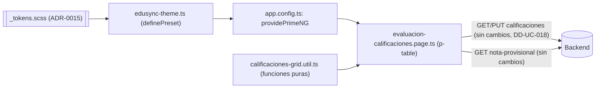

# Design Doc `DD-UC-032` — Base de PrimeNG y matriz de calificaciones con `p-table`

> **Qué es**: mejora **de presentación y de experiencia de captura** sobre una pantalla ya implementada (`DD-UC-018`, matriz de calificaciones de `FSD-UC-016`). Instala PrimeNG por primera vez, crea su tema a partir de los tokens de `ADR-0015` y migra **una sola pantalla**: `evaluacion-calificaciones.page.ts`. No cambia contratos REST, RBAC, cálculo de notas ni el modelo de dominio.
>
> **Relación**: ejecuta la primera parte de `ADR-0026` (propuesta). Sienta el precedente (preset de tema + patrón de tabla editable) que reutilizarán las migraciones siguientes y los futuros centralizadores. Es a `DD-UC-018` lo que `DD-UC-020` fue a `DD-UC-004`.
>
> **Estado de las decisiones**: `ADR-0026` *Aceptada* (10/11/2026). `PR-IMPL-032` **ejecutado** el mismo día.

## 1. Objetivo y contexto

- **Qué resuelve**: la matriz de notas es hoy una `<table>` con un `<input type="number">` por fila, estilos en línea y un `Guardar` que envía todas las notas no vacías. No hay estado visual por celda (válida, inválida, modificada), no hay forma rápida de capturar una columna de notas con el teclado y no se distingue lo guardado de lo editado. Es la pantalla de mayor uso del producto.
- **Caso de uso**: `FSD-UC-016` (Calificaciones y cálculo de notas) — [`docs/product/FSD.md`](../product/FSD.md) §4.6. Ya está **completo** (backend + UI) desde `DD-UC-018`; este DD no reabre su estado.
- **Dentro**:
  - Dependencias `primeng` (línea 21.x), `@angular/cdk` (`^21`) y `@primeuix/themes`, con versiones exactas verificadas al ejecutar.
  - `providePrimeNG` con un tema propio (`definePreset`) construido sobre los tokens de `_tokens.scss`.
  - Migración de `evaluacion-calificaciones.page.ts` a `p-table` (nómina × nota) con captura por teclado, estado por celda y envío solo de lo modificado.
  - Tabla del resumen provisional con `p-table` simple.
  - Función pura de validación y de armado de cambios, con tests.
- **Fuera**:
  - Cualquier otra pantalla. `login.page.ts` y `shared/ui/{card,form-field,button}` **no se tocan** (`DD-UC-020`); las demás pantallas conservan su aspecto actual.
  - Cambios de backend: ninguno. El contrato `PUT /evaluaciones/{id}/calificaciones` y `GET .../calificaciones` no cambia.
  - Centralizadores (`ADR-0025` los difirió) y desplazamiento virtual: solo se registra el patrón (ver §8).
  - Iconos (`primeicons`), modo oscuro y temas alternativos. El Figma no los define.
  - Exportación CSV de la matriz: no se pidió.

## 2. Diseño (el "cómo") `[humano+máquina]`

### 2.1 Estructura de archivos

```
frontend/
├── package.json                                   (DELTA — primeng ^21.1, @angular/cdk ^21, @primeuix/themes)
└── src/
    ├── styles/_tokens.scss                         (DELTA solo si hace falta — escala de primario, ver 2.2)
    └── app/
        ├── app.config.ts                           (DELTA — providePrimeNG({ theme }))
        ├── core/ui/
        │   └── edusync-theme.ts                    (NUEVO — definePreset sobre los tokens de ADR-0015)
        └── features/academico/
            ├── evaluacion-calificaciones.page.ts   (REESCRITO — p-table; misma ruta y mismos endpoints)
            └── calificaciones-grid.util.ts         (NUEVO — validarNota / calcularCambios, funciones puras)
```

Sin cambios en `backend/`, `core/auth/`, `shared/ui/`, `app.routes.ts` ni el shell.

### 2.2 Tema (`edusync-theme.ts`)

- `definePreset` parte de un preset base de `@primeuix/themes` y reasigna los tokens semánticos de color, radio y tipografía a los valores de `_tokens.scss`.
- **Regla heredada de `PR-IMPL-020`: ningún color o tamaño se escribe fuera de `_tokens.scss`.** El preset referencia las variables (`var(--color-primary)`, `var(--radius-sm)`, `var(--font-family-base)`...). Si algún token de PrimeNG exige un valor literal (por ejemplo, una escala `50…950` del primario para estados hover), la escala se declara como variables nuevas en `_tokens.scss` y el preset las referencia. Nunca se pegan hexadecimales en el TypeScript.
- Modo oscuro desactivado (el Figma no lo define, `DD-UC-020` §1).
- El tema afecta solo a componentes PrimeNG. Las pantallas no migradas no cambian de aspecto.

### 2.3 Matriz de calificaciones

Se mantiene el contrato de la pantalla actual: misma ruta, mismos endpoints, misma identificación por `estudianteId`.

```
Estudiante            RUDE        Nota [ 0 – puntajeMaximo ]     Estado
────────────────────────────────────────────────────────────────────────
Apellido, Nombre      1234567     [  85,5 ]                      modificada
Apellido, Nombre      7654321     [ 120   ]  ⚠ fuera de rango    inválida
Apellido, Nombre      1111111     [       ]                      sin nota
```

- **Columnas**: Estudiante, RUDE, Nota (`p-inputnumber`, siempre visible), Estado y acción "Ver provisional". El `rude` se muestra, pero **no** es clave de fila (`track` por `estudianteId`) y no se escribe en consola ni en mensajes.
- **Captura por teclado**: `Tab` avanza al siguiente campo y `Enter` mueve el foco a la nota de la fila siguiente. Es la ayuda principal para capturar una lista completa sin ratón.
- **Estado por celda** (se calcula en `calificaciones-grid.util.ts`):

| Estado | Condición | Presentación |
|--------|-----------|--------------|
| `SIN_NOTA` | No hay nota guardada ni editada | Neutro |
| `GUARDADA` | El valor editado es igual al guardado | Neutro |
| `MODIFICADA` | El valor editado difiere del guardado y está en `[0, puntajeMaximo]` | Fila resaltada con el color de acento |
| `INVALIDA` | Fuera de `[0, puntajeMaximo]`, o se borró una nota ya guardada | Campo en estado inválido + mensaje de la celda |

- **Borrar una nota guardada no es posible** (el backend ignora los valores vacíos). Hoy la UI lo omite en silencio y el usuario cree haberla borrado. Con este DD la celda queda `INVALIDA` con el mensaje «Una nota guardada no se puede borrar; ingrese un valor» y `Guardar` se bloquea. Es un cambio deliberado de comportamiento, solo de UI.
- **Guardar**: se habilita si hay al menos una celda `MODIFICADA` y ninguna `INVALIDA`. Envía `PUT .../calificaciones` con **solo las celdas modificadas** (`ADR-0026` §3.5). Un contador muestra «N cambios sin guardar».
- **Después de guardar**: se recarga la nómina (como hoy), el estado de las celdas vuelve a `GUARDADA` y se pide la nota provisional de la primera celda modificada (como hoy).
- **Errores del servidor**: `E_RANGO_INVALIDO` y `E_PERIODO_NO_ABIERTO` se muestran con `p-message` en la parte superior. La validación del cliente es solo ayuda de UX; el servidor sigue siendo la autoridad.
- **Decimales**: el campo admite hasta 2 decimales y usa configuración regional boliviana (coma decimal). Verificar al ejecutar que `57,5` se interpreta como `57.5` (ver §8).
- **Ningún cálculo en la tabla.** La nota provisional sigue viniendo de `GET .../nota-provisional`.
- **Resumen provisional**: tabla `p-table` simple (sección, estado, nota), con la misma información que hoy.

### 2.4 Contratos y tipos

Sin cambios. Se reutilizan `CalificacionFilaResponse`, `UpsertCalificacionesRequest` y `NotaProvisionalResponse` de `calificacion.model.ts`.

```ts
// calificaciones-grid.util.ts (firma orientativa)
export type EstadoCelda = 'SIN_NOTA' | 'GUARDADA' | 'MODIFICADA' | 'INVALIDA';

export function estadoDeCelda(guardado: number | null, editado: number | null, max: number): EstadoCelda;
export function calcularCambios(
  filas: { estudianteId: string; valor: number | null }[],
  editados: Record<string, number | null>,
  max: number,
): { items: { estudianteId: string; valor: number }[]; invalidos: string[] };
```

### 2.5 Diagrama



## 3. Alternativas consideradas

> La decisión de fondo (PrimeNG como única librería) está en `ADR-0026`. Este DD añade decisiones de alcance y de comportamiento.

| Alternativa | Pros | Contras | ¿Elegida? |
|-------------|------|---------|-----------|
| A. Edición por clic (la celda solo muestra el valor y se vuelve campo al pulsar) | Aspecto más limpio | Un clic extra por celda. Para capturar 40 notas es más lento que escribir y pulsar `Enter` | no |
| B. Campo siempre visible en cada fila, con `Enter` hacia la fila siguiente | Captura rápida con teclado; coherente con la tabla actual | Más ruido visual | **sí** |
| C. Migrar varias pantallas a la vez para validar el tema | Valida el tema con más casos | Mezcla riesgo funcional con cambio de estilos; contradice `ADR-0026` §3.4 | no |
| D. Una sola pantalla (la matriz) como primer consumidor | Alcance acotado; la pantalla de mayor uso valida a la vez el tema y el límite de `p-table` | Las demás pantallas siguen con el aspecto anterior un tiempo | **sí** |
| E. Mantener el comportamiento de «borrar = ignorar» | Sin cambio de comportamiento | El usuario cree haber borrado una nota que sigue guardada | no |

## 4. Impacto en las specs vivas `[máquina]`

| Artefacto vivo | Cambio | ¿Delta vs DTI vFinal? |
|----------------|--------|-----------------------|
| `docs/adr/0026-*.md` | Es el ADR que habilita este DD; sin cambio de contenido | ya registrado (delta 14, `DTP` §A.2) |
| `docs/product/FSD.md` (`FSD-UC-016`) | Sin cambio normativo: flujo y criterios de aceptación iguales. Sin cambio en el contrato REST | no |
| `docs/product/DTP.md` | Fila nueva en §A.1. `FSD-UC-016` gana `DD-UC-032` en su lista de Design Docs, sin reabrir su estado `completo` | no |
| `AGENTS.md` | La fila de PrimeNG de §4 deja de decir «aún no está en el `package.json`» al ejecutar | no |
| `docs/PROMPT_MAPPING.md` | Fila `PR-IMPL-032` | no |
| `PR-IMPL-031` (`DD-UC-031`) | La consola Angular de exportación al SIE debe usar PrimeNG si este DD ya se ejecutó (ver §8) | no |
| Baseline `docs/baseline/**` | **No se toca** | — |

> **Recordatorio (regla de oro)**: el baseline congelado de M4 no se toca. Los cambios viven en `docs/product/`, `docs/adr/` y `docs/design/`.

## 5. Prompts usados `[máquina]`

| Prompt | Tarea | Artefacto generado |
|--------|-------|--------------------|
| `PR-IMPL-032` | Instalar PrimeNG 21.x, crear el tema, migrar la matriz de calificaciones y escribir la utilidad de validación con sus tests | `frontend/package.json`, `core/ui/edusync-theme.ts`, `app.config.ts`, `evaluacion-calificaciones.page.ts`, `calificaciones-grid.util.ts` + test |

> Prompt versionado en [`docs/prompts/impl/PR-IMPL-032.md`](../prompts/impl/PR-IMPL-032.md), estado **Ejecutado**.

## 6. Plan de pruebas y evals

- **Unit** (`calificaciones-grid.util.spec.ts`): `estadoDeCelda` y `calcularCambios` — nota igual a la guardada, nota nueva, valor `0` (válido), valor igual a `puntajeMaximo` (válido), valor negativo y mayor que el máximo (inválidos), nota guardada borrada (inválida), celda sin nota que sigue vacía (no se envía), solo se devuelven las modificadas.
- **Integration**: ninguna. No hay contrato REST nuevo ni modificado.
- **Gate automático**: `ng build` en verde. Si `ng test` no puede ejecutarse en el entorno (limitación ya documentada en `DD-UC-004`), se anota; las funciones puras no necesitan navegador.
- **Prueba manual con datos realistas** (obligatoria, es la señal de reversión de `ADR-0026` §6): un curso de **al menos 45 estudiantes**.
  1. Capturar toda la columna usando solo `Tab`/`Enter`. Cada paso responde sin retraso apreciable.
  2. Una nota fuera de rango se marca y bloquea `Guardar`.
  3. Guardar con 3 cambios envía exactamente 3 ítems (comprobar en la pestaña de red).
  4. Borrar una nota guardada la marca inválida.
  5. Con el periodo no `ABIERTO`, el servidor responde `E_PERIODO_NO_ABIERTO` y se muestra el mensaje.
  6. `57,5` se guarda como `57.5`.
  7. La consola del navegador no muestra `rude` ni notas.
- **Verificación visual** contra el Figma de `ADR-0015`: botones, campos y tabla con el azul marino, radios y tipografía de los tokens. `login.page.ts` y las demás pantallas **no cambian** de aspecto (comparar antes y después).
- **Evals de IA**: no aplica.

## 7. Definition of Done (checklist)

- [x] `fsd_uc` declarado y enlazado (`FSD-UC-016`).
- [x] Diseño (§2) y alternativas (§3) documentados.
- [x] ADR creado/enlazado — `ADR-0026` (*Aceptada*).
- [x] §4 Impacto en specs vivas registrado (sin tocar el baseline).
- [x] Prompt versionado en `docs/prompts/impl/` y en `PROMPT_MAPPING.md` — `PR-IMPL-032` (ejecutado).
- [x] `ADR-0026` en estado *Aceptada*.
- [x] Dependencias instaladas (`primeng` 21.1.10, `@angular/cdk` 21.2.14, `@primeuix/themes` 3.1.0) y `ng build` en verde. La matriz vive en un lazy chunk (~568 kB raw / ~98 kB transfer).
- [x] Tests de `calificaciones-grid.util`: **12/12** verde (`ng test --include=…calificaciones-grid.util.spec.ts`).
- [ ] Prueba manual con ≥ 45 estudiantes (§6) — pendiente del humano; señal de reversión de `ADR-0026` §6.
- [x] DTP actualizado (changelog + estado) vía `dtp-sync` tras ejecutar.
- [x] PR declara: prompts usados, archivos generados vs editados a mano (cuando se abra el PR).

## 8. Preguntas abiertas y riesgos

| # | Pregunta / riesgo | Cómo se resuelve |
|---|-------------------|------------------|
| 1 | ¿Cuántas filas aguanta `p-table` con un campo por fila antes de notarse lenta? No se sabe aún | Prueba manual con ≥ 45 filas (§6). Si es lenta, evaluar desplazamiento virtual o paginar en la propia tabla, y si no basta, plan B de `ADR-0026` §6 |
| 2 | ¿El separador decimal de `p-inputnumber` con configuración regional boliviana interpreta bien la coma? | Prueba 6 de §6. Si falla, fijar el formato explícitamente |
| 3 | ¿Los tokens como `var(--color-primary)` son aceptados por `definePreset` en todos los campos, o hacen falta valores literales (escala del primario)? | Probar al ejecutar. Si hace falta, añadir la escala a `_tokens.scss` (§2.2), sin hexadecimales en el TypeScript |
| 4 | ¿`@primeuix/themes` viene ya como dependencia transitiva de `primeng` 21.x o hay que instalarlo? | Verificar con `npm ls` al instalar. Anotar el resultado en `package.json` y en `AGENTS.md` §4 |
| 5 | **Orden respecto a `PR-IMPL-031`**: su consola Angular de exportación al SIE es una pantalla nueva. Con `ADR-0026` Aceptada debe usar PrimeNG | Ejecutar `PR-IMPL-032` antes que el paso de frontend de `PR-IMPL-031`. Si `PR-IMPL-031` se ejecuta primero, esa pantalla se migra después con su propio Design Doc |
| 6 | Cuando se construyan los centralizadores, ¿bastarán las columnas fijas y el orden de `p-table`? | Fuera de alcance. El resultado de la prueba de §6 informa esa decisión |

## 9. Registro de cambios

| Versión | Fecha | Autor | Cambio |
|---------|-------|-------|--------|
| v1.0 | 10/11/2026 | G-EduSync | Creación y aprobación del Design Doc (`DD-UC-032`): base de PrimeNG y migración de la matriz de calificaciones a `p-table`. Ejecución pendiente de `ADR-0026` *Aceptada* |
| v1.1 | 10/11/2026 | G-EduSync | **Ejecución de `PR-IMPL-032`**: `ADR-0026` Aceptada; tema EduSync; matriz con `p-table`; `ng build` verde; 12/12 tests de la utilidad. Prueba manual ≥ 45 estudiantes pendiente del humano |
