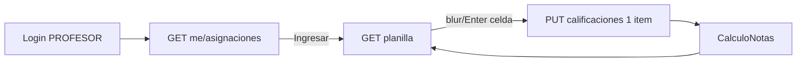

# Design Doc `DD-UC-033` — Planilla Profesor por Curso

> **Qué es**: Design Doc fullstack de `FSD-UC-022`. Cambia la **UX primaria** del `PROFESOR` de «Mis materias → evaluaciones → matriz por evaluación» a **landing por asignación (Curso+Paralelo / Materia / Ingresar)** y **planilla estudiantes × todas las evaluaciones del periodo** con edición inline y columna Promedio. Reutiliza el dominio de `FSD-UC-015`/`016` (`CalculoNotas`, `CalificacionEvaluacion`); no crea un segundo motor de notas.
>
> **Issue**: [#21](https://github.com/aspeti/edusync_m4/issues/21).
>
> **Relación**: consume `DD-UC-012` (asignaciones), `DD-UC-013` (nómina), `DD-UC-015`/`017` (periodos/evaluaciones), `DD-UC-018`/`032` (PUT calificaciones + `p-table`). No toca `notassie` ni `docs/baseline/**`.

## 1. Objetivo y contexto

- **Qué resuelve**: el Profesor, al entrar, ve sus cursos/asignaciones en grilla y carga notas en una sola planilla del trimestre, celda a celda, sin botones Agregar/Editar/Guardar por nota.
- **Caso de uso**: `FSD-UC-022` — [`docs/product/FSD.md`](../product/FSD.md) §4.6.12.
- **Dentro**:
  - `GET /api/v1/profesores/me/asignaciones` — una fila por (`materiaId`, `cursoId`, `paraleloId`) del JWT.
  - `GET /api/v1/materias/{materiaId}/planilla?cursoId=&paraleloId=&periodoId=` — composición (columnas de evaluaciones + filas de estudiantes + `notaPeriodo` provisional).
  - Delta de escritura: `PUT /api/v1/evaluaciones/{id}/calificaciones` acepta `valor: null` para **borrar** la calificación de esa celda (cierra el hueco vs `DD-UC-032`, alineado a `FSD-UC-022`).
  - UI landing `/academico/mis-cursos` + planilla `/academico/mis-cursos/planilla` (query params de la tripleta + periodo).
  - Redirect post-login `PROFESOR` → `/academico/mis-cursos`; nav shell «Mis cursos».
  - `p-table` + `p-inputnumber` (`ADR-0026`); tokens `ADR-0015`.
- **Fuera**:
  - Alta/anulación/metadatos de `Evaluacion` (sigue en `FSD-UC-015` / `materia-evaluaciones`).
  - Exportación SIE, `audit_log`, inmutabilidad (`ADR-0025` §3.7).
  - Recalcular o mostrar promedios en el frontend.
  - Eliminar `/academico/mis-materias` ni la matriz por evaluación (`evaluacion-calificaciones`): quedan como camino secundario para gestionar evaluaciones / captura por una sola evaluación.
  - ADR nuevo (no hace falta: es composición UX + endpoint de lectura).

## 2. Diseño (el "cómo") `[humano+máquina]`

### 2.1 Enfoque

| Pieza | Decisión |
|-------|----------|
| Landing | Endpoint dedicado `GET /profesores/me/asignaciones` (no reusar `GET /materias/mias`, que **deduplica** por materia y pierde curso/paralelo). |
| Planilla | Un GET de composición; el cliente **no** arma la matriz con N llamadas por evaluación (salvo el PUT puntual al guardar celda). |
| Persistencia | Reusar `PUT .../evaluaciones/{id}/calificaciones` con lote de **1 ítem** al blur/Enter. |
| Promedio | Campo `notaPeriodo` por fila, calculado solo con `CalculoNotas` en el servidor. |
| Vacío | `valor: null` → elimina la fila `CalificacionEvaluacion` (si existía) o no-op. |
| Periodo | Igual que Profesor en `DD-UC-021`/`FSD-UC-015`: 1 `ABIERTO` → implícito; 0 o >1 → selector. |
| RBAC | `PROFESOR` (asignación obligatoria) + `ADMIN` override. Cross-tenant / no asignado → **404**. |

### 2.2 Contratos REST

#### `GET /api/v1/profesores/me/asignaciones`

- Auth: `PROFESOR` o `ADMIN` (si Admin sin `profesorId` propio → lista vacía o 404 de uso; **Admin no lista “todas”** en este slice — la landing es del Profesor autenticado).
- Response `200`:

```json
[
  {
    "asignacionId": "uuid",
    "materiaId": "uuid",
    "materiaNombre": "Matemáticas",
    "cursoId": "uuid",
    "cursoNombre": "Primero de Primaria",
    "paraleloId": "uuid",
    "paraleloNombre": "A",
    "cursoEtiqueta": "Primero de Primaria A"
  }
]
```

- `cursoEtiqueta` = `cursoNombre + " " + paraleloNombre` (servidor; la UI no concatena a ciegas reglas distintas).
- Orden: `cursoNombre`, `paraleloNombre`, `materiaNombre`.
- Sin paginación en v1 (cardinalidad acotada por asignaciones del docente). Si crece, reutilizar `PageQuery` en un DD posterior.

#### `GET /api/v1/materias/{materiaId}/planilla?cursoId=&paraleloId=&periodoId=`

- Auth: `ADMIN` | `PROFESOR` | `SECRETARIA` (solo lectura para Secretaria).
- Valida: materia+tenant; para `PROFESOR`, existencia de `AsignacionMateriaProfesor` con esa tripleta; periodo de la gestión activa visible; curso/paralelo coherentes.
- Response `200`:

```json
{
  "materiaId": "uuid",
  "materiaNombre": "string",
  "cursoId": "uuid",
  "cursoNombre": "string",
  "paraleloId": "uuid",
  "paraleloNombre": "string",
  "cursoEtiqueta": "string",
  "periodoId": "uuid",
  "periodoNombre": "string",
  "periodoEstado": "ABIERTO|PENDIENTE|CERRADO|CONFIGURADO",
  "editable": true,
  "columnas": [
    {
      "evaluacionId": "uuid",
      "nombre": "Quiz 1",
      "seccionEvaluacionId": "uuid",
      "seccionNombre": "Saber",
      "seccionOrden": 2,
      "puntajeMaximo": 45,
      "fecha": "2026-08-01"
    }
  ],
  "filas": [
    {
      "estudianteId": "uuid",
      "nombreCompleto": "string",
      "rude": "string",
      "notas": { "<evaluacionId>": 40.0 },
      "notaPeriodo": 93
    }
  ]
}
```

- `columnas`: solo evaluaciones `ACTIVA` del `periodoId` para esa materia; orden `seccionOrden`, `fecha`, `nombre`.
- `filas`: inscripción `ACTIVA` en gestión del periodo ∩ (`cursoId`,`paraleloId`); `notas` omite claves sin valor (o `null` explícito — elegir uno en implementación y documentar; preferir omitir clave = sin nota).
- `notaPeriodo`: entero o `null` si incompleto según `CalculoNotas` (`FSD-UC-016`).
- `editable`: `periodoEstado == ABIERTO` **y** actor con permiso de escritura.
- Errores: `404 E_MATERIA_NO_ENCONTRADA` / `E_PERIODO_NO_ENCONTRADO` / `E_PLANILLA_NO_ENCONTRADA` (tripleta); `422` no aplica en GET.

#### `PUT /api/v1/evaluaciones/{id}/calificaciones` (delta)

```json
{ "items": [ { "estudianteId": "uuid", "valor": 40.0 } ] }
{ "items": [ { "estudianteId": "uuid", "valor": null } ] }
```

- `valor: null` → borrar calificación si existe.
- Resto igual a `DD-UC-018` (`E_RANGO_INVALIDO`, `E_PERIODO_NO_ABIERTO`, `E_EVALUACION_NO_ACTIVA`, `E_ESTUDIANTE_NO_INSCRITO`).
- Respuesta: puede devolver `notaPeriodo` del estudiante tocado (opcional pero recomendado para evitar un GET completo tras cada celda). Si no, el cliente re-GET de planilla o `nota-provisional`.

### 2.3 Capas (hexagonal / Modulith)

```
academico/
├── application/
│   ├── port/in/
│   │   ├── ListarMisAsignacionesUseCase.java
│   │   ├── ObtenerPlanillaMateriaUseCase.java
│   │   └── MisAsignacionVista.java / PlanillaMateriaVista.java (records)
│   └── service/
│       ├── ListarMisAsignacionesService.java
│       └── ObtenerPlanillaMateriaService.java   // orquesta repos + CalculoNotas
├── infrastructure/adapter/in/rest/
│   ├── ProfesorMeController.java               // GET .../profesores/me/asignaciones
│   └── MateriaController.java                  // DELTA GET .../planilla
└── (EvaluacionController — DELTA null-clear en UpsertCalificaciones)
```

Sin Flyway nuevo (salvo que el clear requiera algo; no). Sin cambios en `CalculoNotas` fórmula.

### 2.4 Frontend

```
features/academico/
├── mis-cursos-list.page.ts          // landing p-table
├── planilla-curso.page.ts           // planilla editable
└── planilla.model.ts                // DTOs
```

- Rutas (`app.routes.ts`), **antes** de rutas genéricas de materias:
  - `/academico/mis-cursos` → `MisCursosListPage` (`PROFESOR`, opcional `ADMIN`).
  - `/academico/mis-cursos/planilla` → `PlanillaCursoPage` con query `materiaId`, `cursoId`, `paraleloId`, `periodoId?`.
- Landing columnas: Curso (`cursoEtiqueta`), Materia, Acciones → Ingresar.
- Planilla: primera col Estudiante (+ RUDE visible, no clave); columnas dinámicas por `columnas[]`; última Promedio (`notaPeriodo`, solo lectura).
- Celda: `p-inputnumber`; blur/Enter → PUT 1 ítem; Enter baja a la misma columna fila siguiente (patrón `DD-UC-032`).
- Sin botones Agregar/Editar/Guardar por celda. Toast/`p-message` solo para errores de servidor no atribuibles a una celda.
- Error `E_RANGO_INVALIDO` → mensaje en celda; no persistir.
- Periodo no `ABIERTO` → inputs disabled + aviso.
- Shell: «Mis cursos» → `/academico/mis-cursos`; login redirect `PROFESOR` igual.
- Enlace secundario opcional en planilla: «Gestionar evaluaciones» → `/academico/materias/:id/evaluaciones` (conserva `FSD-UC-015`).



## 3. Alternativas consideradas

| Alternativa | Pros | Contras | ¿Elegida? |
|-------------|------|---------|-----------|
| A. Extender `GET /materias/mias` con curso/paralelo | Menos rutas | Hoy deduplica por materia; rompe consumidores (asistente `list_mis_materias`) | no |
| B. Cliente arma planilla con N× GET calificaciones | Sin endpoint nuevo | N+1, race, promedio a mano en UI | no |
| C. Endpoint planilla + PUT existente (+ null clear) | Un GET compuesto; reusa dominio; autosave simple | Delta pequeño en upsert | **sí** |
| D. Websocket / PATCH celda dedicado | Ideal offline | Overkill; ADR nuevo | no |

> Sin ADR nuevo: no cambia stack ni invariantes de cálculo; solo composición y UX.

## 4. Impacto en las specs vivas `[máquina]`

| Artefacto vivo | Cambio | ¿Delta vs DTI vFinal? |
|----------------|--------|-----------------------|
| `docs/product/FSD.md` (`FSD-UC-022`) | Anotar `DD-UC-033` / `PR-IMPL-033` en trazabilidad | no |
| `docs/product/PRD.md` (`PRD-US-031`) | Sin cambio de requisito (ya v2.5) | no |
| `docs/product/DTP.md` | §A.3 `FSD-UC-022` → diseñado / en progreso → completo al ejecutar | no |
| `docs/PROMPT_MAPPING.md` | Registrar `PR-IMPL-033` | no |

## 5. Prompts usados `[máquina]`

| Prompt | Tarea | Artefacto generado |
|--------|-------|--------------------|
| `PR-IMPL-033` | Backend endpoints + null-clear + UI landing/planilla | `backend/...`, `frontend/features/academico/mis-cursos*`, `planilla-curso*` |

## 6. Plan de pruebas y evals

- **Unit**: `ObtenerPlanillaMateriaService` (orden columnas, solo ACTIVA, `notaPeriodo` vía `CalculoNotas`); upsert con `valor null` elimina; rechazo rango.
- **Integration** (Testcontainers): Profesor ve solo sus asignaciones; cross-tenant 404; planilla filtra nómina por curso/paralelo; PUT null borra; periodo no ABIERTO → 422 en escritura.
- **UI / build**: `ng build` verde; smoke: landing → Ingresar → blur persiste.
- **Gherkin**: escenarios de `FSD-UC-022` §4.6.12.
- **MUST NOT**: assert de promedio calculado en TS; golden `CalculoNotasTest.redondeoHalfUpNoFloor` sigue verde.

## 7. Definition of Done (checklist)

- [x] `fsd_uc` declarado (`FSD-UC-022`).
- [x] Diseño (§2) y alternativas (§3) documentados.
- [x] Sin ADR nuevo (justificado).
- [x] §4 Impacto registrado.
- [x] `PR-IMPL-033` en `docs/prompts/impl/` + `PROMPT_MAPPING`.
- [x] Tests/evals pasando (`PlanillaProfesorIntegrationTest` + `ModularityTests`; `ng build`) — 10/11/2026.
- [x] DTP actualizado vía `dtp-sync` tras ejecución (`DTP` v1.61).
- [ ] PR declara prompts / archivos generados vs editados.
- [x] Issue #21 referenciado en el Design Doc / prompt.

## 8. Notas de ejecución

1. Declarar `GET /profesores/me/asignaciones` **antes** de `GET /profesores/{id}` si comparten controlador (evitar capturar `me` como UUID).
2. Tras null-clear, actualizar o anotar `DD-UC-032` §2.3 (la UI antigua de matriz puede seguir bloqueando borrar; la planilla nueva sí borra).
3. No loguear `rude` ni valores de nota.
4. Tras implementar: `@dtp-sync` y cerrar casillas DoD.
