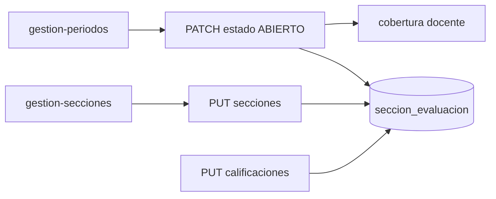

# Design Doc `DD-UC-034` — Rangos en sección + Periodos sin panel de parámetros

> **Qué es**: delta fullstack sobre `FSD-UC-014` (y UI de `FSD-UC-013` / gates de `FSD-UC-009`) que mueve `rangoMin`/`rangoMax` a propiedades de `SeccionEvaluacion`, retira `ParametroPeriodo` y limpia la pantalla de Periodos. Formaliza `ADR-0027`.

> **Relación**: supersede la parte de rangos de `DD-UC-029`; **conserva** el gate `E_MATERIA_SIN_DOCENTE` al abrir. No toca `CalculoNotas` más allá de la validación de rango al persistir calificaciones.

## 1. Objetivo y contexto

- **Qué resuelve:** el Admin configura `nota`, `rangoMin` y `rangoMax` **una sola vez** en Secciones (plantilla de la gestión). Todos los periodos usan esa plantilla. La UI de Periodos solo muestra nombre, inicio, fin, estado y acciones.
- **Casos de uso:** `FSD-UC-014` (principal), `FSD-UC-013` (UI), `FSD-UC-009` (gates al abrir) — `docs/product/FSD.md` v2.20.
- **Dentro:**
  - Campos `rangoMin`/`rangoMax` en dominio `SeccionEvaluacion`, JPA, DTOs REST, seed (0 / `nota`).
  - Flyway nueva versión: `ALTER` + backfill; dropear `parametro_periodo` (o dejar tabla vacía deprecada y borrar en la misma migración).
  - Retirar aggregate/servicios/endpoints `ParametroPeriodo` y el bloque de parámetros en `gestion-periodos.page.ts`.
  - Ampliar `gestion-secciones.page.ts` con columnas mín/máx.
  - Al abrir periodo: validar rangos de secciones + Σ=100 + cobertura docente; **sin** `E_PARAMETROS_*`.
  - Validar `CalificacionEvaluacion` en `[rangoMin, rangoMax]`.
- **Fuera:**
  - Cambiar la fórmula de `CalculoNotas` o `puntajeMaximo` (sigue = `nota`).
  - Snapshot histórico de rangos por periodo (aceptado: plantilla viva, mismo riesgo que `ADR-0014` sobre secciones).
  - Reglas `SUMA`/`MEJOR_N`; `audit_log`; baseline.

## 2. Diseño (el "cómo") `[humano+máquina]`

### 2.1 Dominio

`SeccionEvaluacion.crear(...)` / `actualizar(...)` reciben `rangoMin`, `rangoMax` además de `nota`. Validar en el aggregate (o servicio de aplicación si la suma 100 ya vive ahí):

- `nota` ∈ (0, 100] (igual que hoy).
- `rangoMin ≥ 0`, `rangoMax > rangoMin`, `rangoMax ≤ nota` → si no, `E_RANGO_INVALIDO`.

Seed en `CrearGestionEscolarService`: para cada sección default, `rangoMin = 0`, `rangoMax = nota`.

### 2.2 Persistencia

Migración Flyway (siguiente `V*` tras la última aplicada):

1. `ALTER TABLE seccion_evaluacion ADD COLUMN rango_min ... NOT NULL DEFAULT 0`, `rango_max ...` (backfill `rango_max = nota` donde nulo).
2. Opcional: si existen filas en `parametro_periodo`, no es obligatorio fusionarlas (plantilla única); defaults bastan. Luego `DROP TABLE parametro_periodo` (+ políticas RLS).
3. RLS de `seccion_evaluacion` sin cambio de política.

### 2.3 API

| Método | Path | Cambio |
|--------|------|--------|
| GET/PUT/POST `.../gestiones-escolares/{id}/secciones` | body/response incluyen `rangoMin`, `rangoMax` |
| PATCH `/secciones-evaluacion/{id}` | acepta `rangoMin?`, `rangoMax?` |
| GET/PUT `/periodos-evaluacion/{id}/parametros` | **eliminar** |
| PATCH `.../estado` → `ABIERTO` | deja de consultar `ParametroPeriodo`; valida rangos de secciones |

### 2.4 UI

- `gestion-periodos.page.ts`: quitar filas anidadas de parámetros, `filasPorPeriodo`, `guardarParametros`, llamadas a `/parametros`.
- `gestion-secciones.page.ts`: inputs de mín/máx por fila; PUT envía los cuatro campos; hint de que aplican a todos los periodos.

### 2.5 Calificaciones

Donde hoy se valida contra `[0, seccion.nota]` (o contra `ParametroPeriodo`), usar `[seccion.rangoMin, seccion.rangoMax]`.

## 3. Alternativas consideradas

| Alternativa | Pros | Contras | ¿Elegida? |
|-------------|------|---------|-----------|
| A. Status quo `ParametroPeriodo` | Cero migración | UX incorrecta | no |
| B. Seed de `ParametroPeriodo` sin UI | Menos ruptura API | Dos fuentes de verdad | no |
| C. Campos en `SeccionEvaluacion` + retirar `ParametroPeriodo` | Una fuente; UX clara | Migración + tests | **sí** (`ADR-0027`) |

## 4. Impacto en las specs vivas `[máquina]`

| Artefacto vivo | Cambio | ¿Delta vs DTI vFinal? |
|----------------|--------|-----------------------|
| `docs/product/FSD.md` v2.20 | `FSD-UC-014`/`013`/`009`, BR-018/019, diccionario | no (capa viva) |
| `docs/adr/0027-*.md` | Nueva decisión | sí → ADR |
| `docs/product/DTP.md` | §A.1/§A.3 vía `@dtp-sync` tras ejecutar | sí (delta A.2: alcance rangos) |
| `docs/PROMPT_MAPPING.md` | `PR-IMPL-034` | no |
| `docs/design/DD-UC-029.md` | No reescribir; queda histórico “ejecutado” supersedido en rangos | no |

Baseline intacto.

## 5. Prompts usados `[máquina]`

| Prompt | Tarea | Artefacto generado |
|--------|-------|--------------------|
| `PR-IMPL-034` | Backend + Flyway + UI + tests | `backend/.../academico/**`, `frontend/.../gestion-{periodos,secciones}.page.ts` |

## 6. Plan de pruebas y evals

- **Unit (dominio):** `rangoMax > nota` rechazado; `rangoMin` negativo rechazado; seed con defaults.
- **Unit (aplicación):** abrir periodo sin `ParametroPeriodo` y con secciones válidas → OK; sección con rango inválido → `E_RANGO_INVALIDO`; cobertura docente conservada.
- **Integration:** PUT secciones con rangos; GET refleja campos; endpoints `/parametros` ausentes (404); cross-tenant 404; calificar fuera de rango → 422.
- **UI / build:** `ng build` verde; Periodos sin bloque de parámetros; Secciones con mín/máx.
- **Evals de IA:** no aplica.

## 7. Definition of Done (checklist)

- [x] `fsd_uc` declarado y enlazado (`FSD-UC-014`/`013`/`009`).
- [x] Diseño (§2) y alternativas (§3) documentados.
- [x] `ADR-0027` creado y enlazado.
- [x] §4 Impacto en specs vivas registrado (sin tocar baseline).
- [x] Prompt `PR-IMPL-034` en `docs/prompts/impl/` y `PROMPT_MAPPING.md`.
- [x] Tests/evals pasando (`mvn test` verde, incluye `ModularityTests`; `ng build` verde).
- [x] DTP actualizado vía `dtp-sync` tras implementación.
- [ ] PR declara prompts y archivos generados vs editados a mano.
